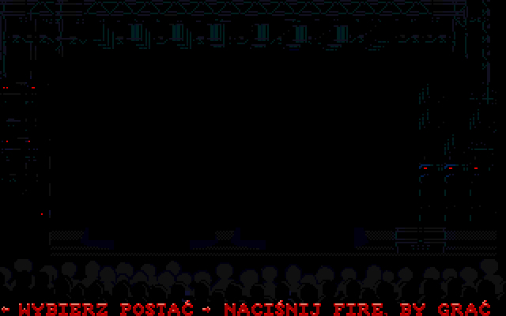

# The Blues Brothers (1991, MS-DOS) — Polish translation & smooth scrolling

[Polski](README.pl.md)

Release **1.1.0** combines an optional Polish translation and an independent
smooth-scroll mod for the original Titus DOS game. English smooth scrolling
changes **only `1.EXE`**: it does not install Polish text, graphics or fonts.
Level data, controls and sound are unchanged; smooth scrolling does affect
when enemies activate.



## Play: install the release patch

You need your own legally obtained copy of the **supported English DOS
hard-disk TDT/TRSI edition** and **Python 3.8+**. Python is the patch installer's
only dependency; players do **not** need Pillow, numpy or NASM. Run the resulting
game in DOS, for example with DOSBox-X.

1. Download `blues-brothers-1.1.0-patch.zip` and `SHA256SUMS` from
   [release v1.1.0](https://github.com/grzebla/blues-brothers-pl/releases/tag/v1.1.0),
   verify the ZIP's SHA-256 against `SHA256SUMS`, then extract it.
2. From the extracted patch directory, run these commands in your host system's
   terminal, **not** inside DOSBox. Replace `SOURCE` with the original game
   directory and `NEW_DIR` with a **new, nonexistent** directory whose parent
   directory already exists:

   ```sh
   python apply_patch.py SOURCE --check
   python apply_patch.py SOURCE --output NEW_DIR
   ```

   Use `python3` if that is your Python 3 command; quote paths containing spaces.
3. Mount `NEW_DIR` in DOSBox-X and run `START.COM`.

The repository is **private**: release and repository links require access.
The patch ZIP can also be shared separately. It contains no complete original
game files and is not a game download.

Installation is **out of place**: the source is left untouched. The result is
`START.COM` plus four complete, independently runnable game directories:

| Profile | Directory | Language | Scrolling |
|---|---|---|---|
| `en-original` | `ENORIG` | English | Original |
| `en-smooth` | `ENSMOOTH` | English | Smooth; only `1.EXE` modified |
| `pl-original` | `PLORIG` | Polish | Original |
| `pl-smooth` | `PLSMOOTH` | Polish | Smooth |

`START.COM` has two screens: **Language/Język** (`1 English`, `2 Polski`),
then **Original version / Smooth scroll** or **Wersja oryginalna / Płynne
przewijanie**. It always starts VGA directly, without the old cracktro menu.
For English smooth scrolling alone, choose English → Smooth scroll, or enter
`ENSMOOTH` and run `1.EXE`. There is no `--variant` installation option.

There is no `--restore` in this format: keep using the untouched source to play
the original. A copy patched with 1.0 must first be restored with its **old 1.0
installer**, or replaced with a clean copy.

[Installation and troubleshooting](docs/install.md) ·
[Compatibility and test results](docs/compatibility.md)

## Supported base and smooth-scroll caveats

- Base `1.EXE`: **196608 bytes**, SHA-256
  `769ee254b154a9444205524ec4b28a8147a372ac5b2cee2e25fcd83aa90d0add`.
  The installer validates **all 50 files in `KNOWN_FILES`**, not just the EXE.
  Other editions are not supported.
- Tested emulators: **DOSBox-X 2026.01.02** and **2026.10.01 SDL2**; use `machine=svga_s3`,
  `memsize=16`, `core=normal`, `cycles=fixed 20000`. About 12000 cycles or more
  are needed for full speed (~23 fps); 3000 is too slow even for the original.
- Smooth scrolling follows the player at **1-pixel precision in both axes**.
  Enemy activation changes, so recorded demos lose sync after about **60 s**.
- Two-player mode, character switching and real hardware remain unconfirmed.
  See [the recorded 1.1.0 test scope](docs/compatibility.md) for the distinction
  between current acceptance checks and historical reports.

[How the scrolling mod works](mods/smooth_scroll/README.md)

## What is translated

The game uses bitmap artwork rather than a general-purpose text font.

| Location | English | Polish |
|---|---|---|
| Character selection | CHOOSE YOUR PLAYER / PRESS FIRE TO START | WYBIERZ POSTAĆ / NACIŚNIJ FIRE, BY GRAĆ |
| Game-over sprite | GAME OVER | KONIEC GRY |
| Extra-life sprite | 1UP | +1 ŻYCIE |
| Between-level map | CHEMICALS, STORE | CHEMIA, SKLEP |
| Level 1 signs and reflections | STORE, MUSIC | SKLEP, PŁYTY |
| Level 5 plaque | PROGRAMMER | PROGRAMISTA |
| Disk prompt | INSERT DISK II | WŁÓŻ DYSK II |
| DOS errors | VIDEO ERROR. / OUT OF MEMORY. | BRAK EGA/VGA. / BRAK RAM-U. |

Names (The Blues Brothers, Jake, Elwood, Titus), graffiti and HI-FI stay as-is.
The tiny OPEN sign remains English because a Polish equivalent does not fit
(status `review`). Legacy RUNME strings are also localized, but the release
launcher does not use that menu. Full list:
[`localization/pl/strings.json`](localization/pl/strings.json).

## Build from a clone (developers only)

Repository access is required. Install Python 3, Pillow, numpy and **NASM**
(the `nasm` command; on macOS: `brew install nasm`). DOSBox-X is needed only
for emulator tests. These are **build dependencies**, not player dependencies.

```sh
git clone https://github.com/grzebla/blues-brothers-pl.git
cd blues-brothers-pl
python3 -m pip install Pillow numpy
nasm -v
```

Copy your clean, supported game files into `original/`; never publish them.
Build a single profile using `--locale en|pl` and `--scroll original|smooth`:

```sh
python3 tools/build.py --source original --locale en --scroll original --output build/en-original
python3 tools/build.py --source original --locale en --scroll smooth --output build/en-smooth
python3 tools/build.py --source original --locale pl --scroll original --output build/pl-original
python3 tools/build.py --source original --locale pl --scroll smooth --output build/pl-smooth
```

Each build writes `game/`, `manifest.json` and `report.txt` under its output
directory. Defaults remain **Polish + smooth**; `--classic-scroll` is an alias
for `--scroll original`.

To create the release, the generator builds **all four profiles and the
launcher itself**; it no longer accepts a `--build` option:

```sh
python3 tools/make_patch.py --source original --output patches/dist --version 1.1.0
```

Output: `patches/dist/blues-brothers-1.1.0-patch.zip` and
`patches/dist/SHA256SUMS`. The generator refuses to overwrite a package with
an existing version number; use another `--output` directory or a new version.
Do not distribute `original/` or built game directories.

### Editing the Polish translation

Edit `translation` in `localization/pl/strings.json`. Respect `max_size`,
the glyphs available in each bitmap font (`python3 tools/font_specimen.py`),
and the engine's resource limits. The character-selection font covers all
Polish capitals; sign fonts contain only the glyphs currently needed.
Legacy `runme.*` replacements must be ASCII and exactly the original byte
length (space-padded); `exe.*` messages share a **26-character** budget.

Preview with `python3 tools/make_graphics.py --preview work/preview`, or rebuild
Polish graphics with `python3 tools/build.py --render`. For hand-edited indexed
PNGs in `localization/pl/graphics/`, keep the palette and set `"mode": "manual"`.
System macOS fonts are optional for regenerating large-letter masks.
See [formats and limits](docs/file-formats.md) and [reverse-engineering notes](docs/analysis.md)
(both in Polish).

### Automated tests

Run `tests/run_tests.sh` for tools and installer checks. DOSBox-X integration
tests additionally require [Varlock](https://varlock.dev) on `PATH`:
`tests/run_tests.sh --dosbox`. Test the four launcher choices with:

```sh
python3 tests/run_launcher_tests.py --game build/bundle --out tests/results/launcher \
  --dosbox /path/to/dosbox-x
```

Here `build/bundle` is the installed four-profile directory. For headless tests
on macOS use **DOSBox-X 2026.10.01 SDL2**: 2026.01.02 has surface-renderer
crashes during mode changes with dummy video. `tests/run_dosbox_tests.py` also
accepts `--dosbox /path/to/dosbox-x`. The harness uses
Varlock and the checked-in `.env.schema` to enforce SDL dummy video/audio:
**no windows, no focus stealing, no sound on the host**. Video and audio are
still captured for assertions; the distributed game is not muted. There is
no GUI fallback. Varlock and DOSBox-X are not required to build or install
the patch. See [compatibility and recorded results](docs/compatibility.md).

## Repository map and licenses

- `tools/`: codecs, extraction/import, graphics generation, builds, patch packaging;
  `tools/patcher/apply_patch.py`: player installer.
- `localization/pl/`: strings, six bitmap-font styles, graphics and masks.
- `mods/`: launcher and smooth-scroll code; `patches/`: patch specifications/output.
- `tests/`: tool checks, DOSBox-X harness and historical results; `docs/`: technical notes.
- `original/`, `work/`, `build/`: local game data and working/output directories.

Project code, including launcher and scrolling code: **MIT**. Localization:
**CC BY 4.0**. The game remains © 1991 Titus Interactive; original game and
TDT/TRSI material retain their respective rights. See [LICENSE](LICENSE).
