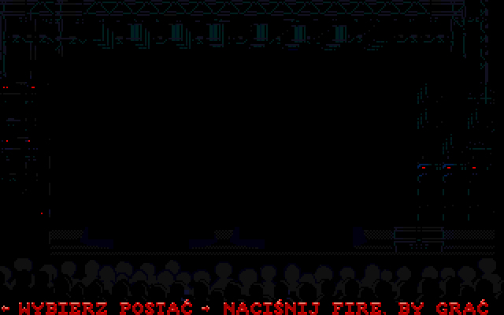

# The Blues Brothers (1991, MS-DOS) — polska wersja i płynne przewijanie

[English](README.md)

Wydanie **1.1.0** łączy opcjonalną polonizację i niezależny mod płynnego
przewijania oryginalnej gry Titus na DOS. Angielski profil z płynnym
przewijaniem zmienia **wyłącznie `1.EXE`**: bez polskich tekstów, grafik ani
fontów. Dane poziomów, sterowanie i dźwięk pozostają bez zmian; płynne
przewijanie wpływa jednak na moment aktywacji przeciwników.



## Dla graczy: instalacja patcha z Release

Potrzebne są legalnie posiadana kopia **obsługiwanej angielskiej wersji DOS
na dysk twardy, wydanie TDT/TRSI**, oraz **Python 3.8+**. Python to jedyna
zależność instalatora; gracze **nie potrzebują Pillow, numpy ani NASM**.
Wynikowa gra działa w DOS, np. w DOSBox-X.

1. Pobierz `blues-brothers-1.1.0-patch.zip` i `SHA256SUMS` z
   [wydania v1.1.0](https://github.com/grzebla/blues-brothers-pl/releases/tag/v1.1.0),
   porównaj SHA-256 ZIP-a z `SHA256SUMS`, następnie rozpakuj paczkę.
2. W katalogu rozpakowanego patcha uruchom poniższe polecenia w terminalu
   systemu gospodarza, **nie** w DOSBox. Zastąp `SOURCE` katalogiem oryginału,
   a `NEW_DIR` ścieżką **nowego, jeszcze nieistniejącego** katalogu, którego
   katalog nadrzędny już istnieje:

   ```sh
   python apply_patch.py SOURCE --check
   python apply_patch.py SOURCE --output NEW_DIR
   ```

   Jeśli Python 3 ma u Ciebie nazwę `python3`, użyj jej zamiast `python`.
   Ścieżki ze spacjami ujmij w cudzysłowy.
3. Zamontuj `NEW_DIR` w DOSBox-X i uruchom `START.COM`.

Repozytorium jest **prywatne**: linki do repo i Release wymagają dostępu.
ZIP patcha można też przekazać osobno. Paczka nie zawiera kompletnych
oryginalnych plików gry i nie zastępuje posiadania gry.

Instalacja odbywa się **poza źródłem (out of place)**: oryginał pozostaje
nienaruszony. Wynik to `START.COM` i cztery kompletne katalogi gry, z których
każdy można uruchomić niezależnie:

| Profil | Katalog | Język | Przewijanie |
|---|---|---|---|
| `en-original` | `ENORIG` | angielski | oryginalne |
| `en-smooth` | `ENSMOOTH` | angielski | płynne; zmieniony tylko `1.EXE` |
| `pl-original` | `PLORIG` | polski | oryginalne |
| `pl-smooth` | `PLSMOOTH` | polski | płynne |

`START.COM` ma dwa ekrany: **Language/Język** (`1 English`, `2 Polski`),
a potem **Original version / Smooth scroll** lub **Wersja oryginalna /
Płynne przewijanie**. Zawsze uruchamia VGA bezpośrednio, bez starego menu
cracktra. Aby grać tylko po angielsku z płynnym przewijaniem, wybierz
English → Smooth scroll albo wejdź do `ENSMOOTH` i uruchom `1.EXE`.
Nie ma opcji instalatora `--variant`.

Nowy format nie ma `--restore`: oryginał nadal jest w katalogu źródłowym.
Kopię zmienioną patchem 1.0 trzeba najpierw odtworzyć **starym instalatorem
1.0** albo zastąpić czystą kopią gry.

[Instalacja i rozwiązywanie problemów](docs/install.pl.md) ·
[Zgodność i wyniki testów](docs/compatibility.pl.md)

## Obsługiwana baza i ograniczenia płynnego przewijania

- Bazowy `1.EXE`: **196608 bajtów**, SHA-256
  `769ee254b154a9444205524ec4b28a8147a372ac5b2cee2e25fcd83aa90d0add`.
  Instalator sprawdza **wszystkie 50 plików `KNOWN_FILES`**, nie tylko EXE.
  Inne wydania nie są obsługiwane.
- Testowane emulatory: **DOSBox-X 2026.01.02** i **2026.10.01 SDL2**; ustawienia:
  `machine=svga_s3`, `memsize=16`, `core=normal`, `cycles=fixed 20000`.
  Pełna prędkość (~23 kl./s) wymaga ok. 12000 cykli lub więcej;
  3000 to za mało także dla oryginału.
- Kamera płynnego przewijania śledzi gracza z dokładnością **1 px w obu
  osiach**. Inny moment aktywacji przeciwników sprawia, że nagrane dema
  tracą synchronizację po ok. **60 s**.
- Tryb dwóch graczy, przełączanie postaci i prawdziwy sprzęt nie są
  potwierdzone. [Zapisany zakres testów 1.1.0](docs/compatibility.pl.md)
  rozróżnia bieżące testy odbiorcze i raporty historyczne.

[Opis techniczny moda](mods/smooth_scroll/README.pl.md)

## Co zostało przetłumaczone

Gra używa napisów bitmapowych zamiast uniwersalnego fontu tekstowego.

| Gdzie | Oryginał | Polska wersja |
|---|---|---|
| wybór postaci | CHOOSE YOUR PLAYER / PRESS FIRE TO START | WYBIERZ POSTAĆ / NACIŚNIJ FIRE, BY GRAĆ |
| koniec gry (sprite) | GAME OVER | KONIEC GRY |
| dodatkowe życie (sprite) | 1UP | +1 ŻYCIE |
| mapa między poziomami | CHEMICALS, STORE | CHEMIA, SKLEP |
| neony poziomu 1 i ich odbicia | STORE, MUSIC | SKLEP, PŁYTY |
| tabliczka poziomu 5 | PROGRAMMER | PROGRAMISTA |
| ekran zmiany dyskietki | INSERT DISK II | WŁÓŻ DYSK II |
| komunikaty DOS | VIDEO ERROR. / OUT OF MEMORY. | BRAK EGA/VGA. / BRAK RAM-U. |

Bez zmian pozostają nazwy własne (The Blues Brothers, Jake, Elwood, Titus),
graffiti i HI-FI. Mała tabliczka OPEN zostaje po angielsku z braku miejsca
(status `review`). Przetłumaczono też historyczne teksty RUNME
(PRZEDSTAWIA, firmy, Intro, „Kto inny da wam takie rzeczy?”), ale launcher
wydania nie korzysta z tego menu. Pełna lista:
[`localization/pl/strings.json`](localization/pl/strings.json).

## Budowanie z klona repozytorium (tylko dla twórców)

Wymagany dostęp do repozytorium. Zainstaluj Python 3, Pillow, numpy oraz
**NASM** (polecenie `nasm`; na macOS: `brew install nasm`). DOSBox-X jest
potrzebny tylko do testów emulatorowych. To **zależności budowania**, nie gracza.

```sh
git clone https://github.com/grzebla/blues-brothers-pl.git
cd blues-brothers-pl
python3 -m pip install Pillow numpy
nasm -v
```

Skopiuj czyste pliki obsługiwanego wydania do `original/`; nie publikuj ich.
Pojedynczy profil buduje się opcjami `--locale en|pl` i `--scroll original|smooth`:

```sh
python3 tools/build.py --source original --locale en --scroll original --output build/en-original
python3 tools/build.py --source original --locale en --scroll smooth --output build/en-smooth
python3 tools/build.py --source original --locale pl --scroll original --output build/pl-original
python3 tools/build.py --source original --locale pl --scroll smooth --output build/pl-smooth
```

Każdy build zapisuje `game/`, `manifest.json` i `report.txt` we wskazanym
katalogu wyjściowym. Domyślnie nadal budowana jest **polska wersja z płynnym
przewijaniem**; `--classic-scroll` jest aliasem `--scroll original`.

Generator wydania sam buduje **wszystkie cztery profile i launcher**;
nie przyjmuje już opcji `--build`:

```sh
python3 tools/make_patch.py --source original --output patches/dist --version 1.1.0
```

Wynik: `patches/dist/blues-brothers-1.1.0-patch.zip` oraz
`patches/dist/SHA256SUMS`. Generator odmawia nadpisania paczki z istniejącym
numerem wersji; wybierz inny katalog `--output` albo nową wersję.
Nie rozpowszechniaj `original/` ani katalogów z gotową grą.

### Zmiana tłumaczenia

Edytuj `translation` w `localization/pl/strings.json`. Zachowaj `max_size`,
zestaw glifów danego fontu (`python3 tools/font_specimen.py`) i limity zasobów
silnika. Font wyboru postaci zawiera wszystkie polskie wielkie litery;
fonty szyldów — tylko glify potrzebne do obecnych napisów. Historyczne wpisy
`runme.*` muszą być w ASCII i mieć dokładnie oryginalną długość bajtową
(dopełnij spacjami); komunikaty `exe.*` mają wspólny limit **26 znaków**.

Podgląd: `python3 tools/make_graphics.py --preview work/preview`, a build
z ponownym wygenerowaniem polskich grafik: `python3 tools/build.py --render`.
Ręcznie edytując indeksowane PNG w `localization/pl/graphics/`, zachowaj paletę
i ustaw `"mode": "manual"`. Systemowe fonty macOS są opcjonalne przy ponownym
generowaniu masek dużych napisów. Zobacz [formaty i limity](docs/file-formats.md)
oraz [analizę silnika](docs/analysis.md).

### Testy automatyczne

Testy narzędzi i instalatora uruchamia `tests/run_tests.sh`. Testy integracyjne
DOSBox-X wymagają dodatkowo [Varlock](https://varlock.dev) w `PATH`:
`tests/run_tests.sh --dosbox`. Cztery wybory launchera sprawdzisz poleceniem:

```sh
python3 tests/run_launcher_tests.py --game build/bundle --out tests/results/launcher \
  --dosbox /ścieżka/do/dosbox-x
```

`build/bundle` oznacza zainstalowany katalog czterech profili. Do bezokienkowych
testów na macOS użyj **DOSBox-X 2026.10.01 SDL2**: wersja 2026.01.02 ma awarie
renderera powierzchni przy zmianie trybu ze sterownikiem dummy.
`tests/run_dosbox_tests.py` również przyjmuje `--dosbox /ścieżka/do/dosbox-x`.
Harness korzysta
z Varlock i dołączonego `.env.schema`, wymuszając sterowniki SDL dummy:
**bez okien, przejmowania fokusu i dźwięku na hoście**. Obraz i audio nadal
są nagrywane do asercji; wydawana gra nie jest wyciszona. Nie ma fallbacku
do GUI. Varlock i DOSBox-X nie są potrzebne do budowania ani instalacji patcha.
Zobacz [zgodność i zapisane wyniki](docs/compatibility.pl.md).

## Struktura i licencje

- `tools/`: kodeki, eksport/import, grafiki, buildy i paczki patcha;
  `tools/patcher/apply_patch.py`: instalator dla graczy.
- `localization/pl/`: teksty, sześć stylów fontów bitmapowych, grafiki i maski.
- `mods/`: kod launchera i przewijania; `patches/`: specyfikacje/wyniki patcha.
- `tests/`: testy narzędzi, harness DOSBox-X i historyczne wyniki; `docs/`: opis techniczny.
- `original/`, `work/`, `build/`: lokalna gra, pliki robocze i wyniki budowania.

Kod projektu, w tym launcher i przewijanie: **MIT**. Lokalizacja: **CC BY 4.0**.
Gra nadal © 1991 Titus Interactive; oryginalne materiały gry i TDT/TRSI
zachowują prawa swoich właścicieli. Zobacz [LICENSE](LICENSE).
